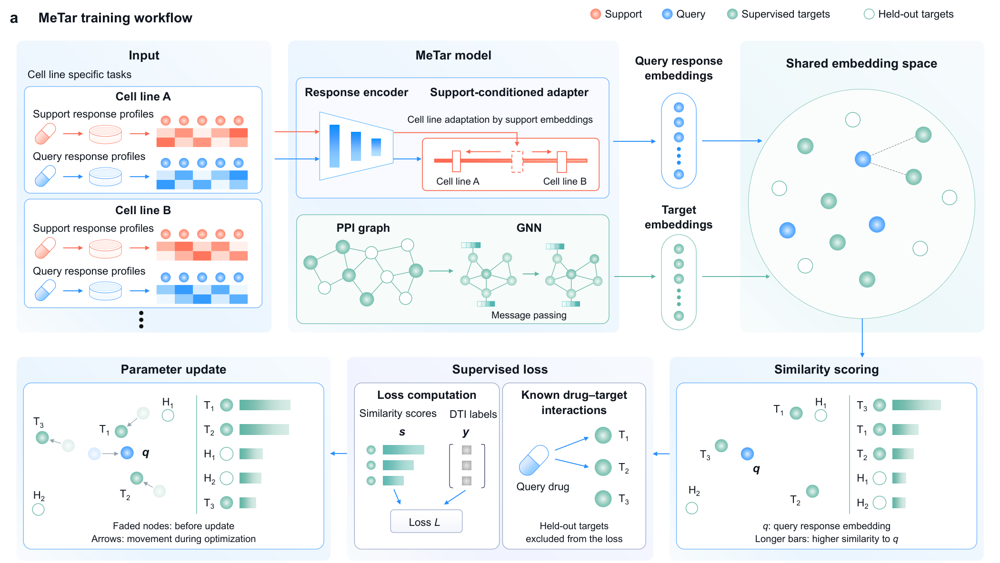
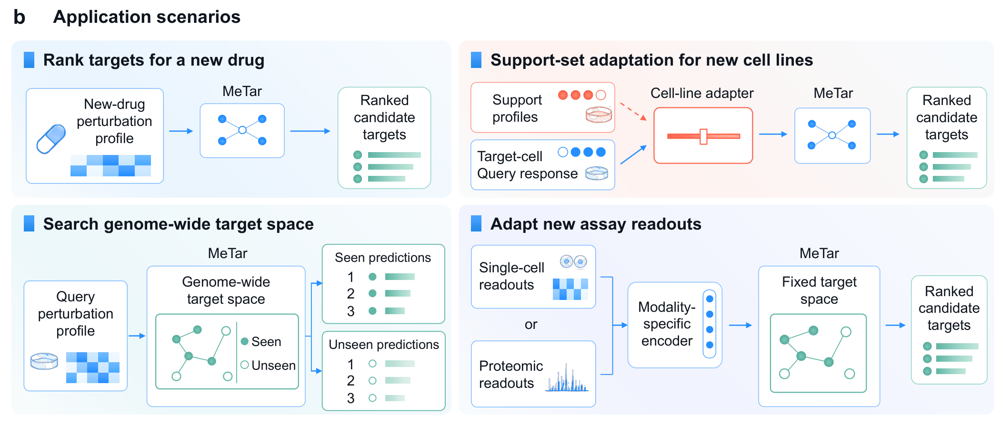

<p align="center">
  
</p>

<h1 align="center">MeTar</h1>

<p align="center">
  <strong>Generalizable phenotype-inverse identification of compound targets<br>
  from perturbational omics</strong>
</p>

<p align="center">
  <a href="pyproject.toml"></a>
  <a href="docs/installation.md"></a>
  <a href="https://github.com/org-Metar/MeTar/releases/tag/artifacts-20261102"></a>
  <a href="#citation"></a>
</p>

<p align="center">
  <a href="#quick-start"><strong>Run the example</strong></a> &nbsp; · &nbsp;
  <a href="#prediction-workflows">Choose a workflow</a> &nbsp; · &nbsp;
  <a href="docs/usage.md">Input guide</a> &nbsp; · &nbsp;
  <a href="#citation">Cite MeTar</a>
</p>

---

<a id="contents"></a>

## 📑 Contents

- [Overview](#overview)
- [Installation](#installation) — environment, pretrained models and data
- [Quick start](#quick-start) — run the included PDF-3 query on CPU
- [Prediction workflows](#prediction-workflows) — choose a route for your data
- [Training and reproduction](#training-and-reproduction)
- [Tutorials and documentation](#tutorials-and-documentation)
- [Repository structure](#repository-structure)
- [Citation](#citation)

---

<a id="overview"></a>

## 💡 Overview

MeTar predicts drug targets from drug-induced perturbation responses. It learns
response and target embeddings in a shared embedding space, using known
drug-target associations as supervision.

- **Target ranking.** A response encoder maps a drug's perturbation response
  into the shared space, where candidate targets are ranked by similarity.
- **Cell-line adaptation.** A support-conditioned adapter uses separate
  reference compounds with known targets to adjust predictions for a cell-line
  context.
- **Genome-wide prediction.** A graph neural network shares parameters across
  genes to generate target embeddings beyond the supervised target set.

<p align="center">
  
  <br>
  <sub>Training workflow: response and target representations are learned together using known drug-target associations.</sub>
</p>

The released models support bulk transcriptomics, single-cell transcriptomics
and protein abundance, with interfaces for new cell lines, genome-wide target
ranking and consensus across cell lines. Direct and support-conditioned
prediction are referred to as **MeTar_direct** and **MeTar_adapted** in the
manuscript.

---

<a id="installation"></a>

## 📦 Installation

### 1. Install the package

Python **3.11 is recommended**. Create an environment with
[uv](https://docs.astral.sh/uv/):

```bash
git clone https://github.com/org-Metar/MeTar.git
cd MeTar
uv venv --python 3.11
```

Activate the environment before using `python` or `metar`:

```bash
# Linux / macOS
source .venv/bin/activate
```

<details>
<summary><strong>Windows PowerShell activation</strong></summary>

```powershell
.\.venv\Scripts\Activate.ps1
```

</details>

Install PyTorch for CPU and the prediction dependencies:

```bash
uv pip install torch --index-url https://download.pytorch.org/whl/cpu
uv pip install -e ".[single-cell,parquet]"
metar describe
```

<details>
<summary><strong>GPU setup and optional dependencies</strong></summary>

For CUDA, select the appropriate wheel using the
[PyTorch installation selector](https://pytorch.org/get-started/locally/), then
install MeTar in that environment. Prediction defaults to CPU; add
`--device cuda:0` to request the GPU.

The [installation guide](docs/installation.md) lists the optional dependencies
for training, raw single-cell preprocessing, plotting and tests.

</details>

### 2. Download pretrained models and data

The [model and data release](https://github.com/org-Metar/MeTar/releases/tag/artifacts-20261102)
contains the checkpoints, target embeddings and fitted preprocessing parameters.
Downloads are public and require no GitHub login.

For the quick start, download and extract these **two archives**:

```bash
python scripts/download_data.py --archive models_and_representations.tar.gz --archive result_data.tar.gz --download --directory ../metar-downloads --package ../metar_artifacts
```

The downloader checks file sizes and SHA-256 values before extraction. Keep
`metar_artifacts` separate from the code checkout, and set its absolute path in
the current terminal:

```bash
# Linux / macOS, run from the repository root
export METAR_ARTIFACT_ROOT="$(cd ../metar_artifacts && pwd)"
```

<details>
<summary><strong>Windows PowerShell artifact path</strong></summary>

```powershell
$env:METAR_ARTIFACT_ROOT = (Resolve-Path ../metar_artifacts).Path
```

</details>

<details>
<summary><strong>Additional archives for other workflows</strong></summary>

| Archive | Used for |
|---|---|
| `application_inputs.tar.gz` | Processed PDF-3 RNA-seq input and target identifiers |
| `tahoe_projection.tar.gz` | Fixed 6,000-gene selection and fitted 128-dimensional single-cell SVD projection |
| `figure_assets.tar.gz` | Native diagram inputs and computational figure assembly |
| `runtime_sources.tar.gz` | Archived training and evaluation runtime sources |
| `training_inputs.tar.gz` | Graph and PC3 inputs for training from scratch |

Select an archive with `--archive NAME`, or list all assets with
`python scripts/download_data.py --list`. The [data guide](docs/data.md)
explains the complete directory layout and which upstream datasets are
obtained separately.

</details>

---

<a id="quick-start"></a>

## ⚡ Quick start

Run the included **PDF-3 query on CPU** after completing installation and data
preparation above. No model training is needed.

```bash
python scripts/prepare_pdf3.py --package ../metar_artifacts --output ../metar-example/pdf3.csv
metar doctor --scenario bulk-668 --input ../metar-example/pdf3.csv --id-column query_id
metar predict bulk-668 --input ../metar-example/pdf3.csv --id-column query_id --cell-line JHH7 --device cpu --top-k 20 --output ../metar-example/pdf3_targets.tsv
```

**Input:** one archived, prepared PDF-3 response with 978 ordered features.
**Output:** `pdf3_targets.tsv`, containing the 20 highest-ranked targets from
668 candidates. The table includes `query_id`, `target`, `score`, `rank` and
`rank_percent`.

Higher scores rank first. `rank_percent` describes a relative rank, not a
binding probability. To save the complete ranking, use `--top-k 0`.

**[Continue with the step-by-step tutorial →](docs/quickstart.md)**

---

<a id="prediction-workflows"></a>

## 🚀 Prediction workflows

Choose the workflow that matches your assay and prediction setting. Each
workflow has specific input requirements; the [prediction guide](docs/usage.md)
provides the preparation steps and model selection for each prediction branch.

| Your task | Workflow | Candidate targets |
|---|---|---|
| Bulk transcriptomic response | [Bulk transcriptomics](#bulk-transcriptomics) | 668 targets |
| A new cell line, with or without support compounds | [Cross-cell prediction](#cross-cell-prediction) | 668 targets |
| Search beyond the supervised target set | [Genome-wide ranking](#genome-wide-ranking) | 16,583 genes |
| Single-cell transcriptomic response | [Single-cell prediction](#single-cell-prediction) | 16,583 genes |
| Protein-abundance response | [Proteomics prediction](#proteomics-prediction) | 16,583 genes |
| Combine results for a compound across cell lines | [Consensus prediction](#consensus-prediction) | The same complete candidate set |

<p align="center">
  
  <br>
  <sub>Application scenarios. Both overview images are excerpts from the MeTar manuscript figure.</sub>
</p>

The paths in the examples below refer to your prepared inputs. Run them from
the repository root with `METAR_ARTIFACT_ROOT` set.

<a id="bulk-transcriptomics"></a>

### 1. Bulk transcriptomics

Rank 668 candidate targets from a prepared 978-feature response profile.

```bash
metar predict bulk-668 --input inputs/bulk.tsv --id-column query_id --feature-order inputs/landmark_order.txt --cell-line PC3 --output outputs/bulk.tsv
```

<a id="cross-cell-prediction"></a>

### 2. Cross-cell prediction

**Direct prediction** uses the shared model without support-compound input:

```bash
metar predict cross-cell --mode direct --cell-line VCAP --input inputs/vcap.tsv --id-column query_id --feature-order inputs/landmark_order.txt --output outputs/vcap_direct.tsv
```

**Adapted prediction** also uses separate support responses and known targets
from the target cell line:

```bash
metar predict cross-cell --mode adapted --cell-line VCAP --input inputs/vcap.tsv --id-column query_id --feature-order inputs/landmark_order.txt --support-input inputs/support.tsv --support-labels inputs/support_labels.tsv --output outputs/vcap_adapted.tsv
```

Adaptation applies the trained adapter at inference; it does not retrain the
model for the new cell line.

<a id="genome-wide-ranking"></a>

### 3. Genome-wide ranking

Rank all 16,583 candidates, including genes outside the supervised target set.

```bash
metar predict full-space --input inputs/full_space.tsv --id-column query_id --feature-order inputs/landmark_order.txt --output outputs/full_space.tsv
```

<a id="single-cell-prediction"></a>

### 4. Single-cell prediction

Use the trained X128 representation for A549, SW480 or NCI-H460. X128 denotes
the fitted 128-dimensional projection, not 128 selected genes. See
[X128 preparation](docs/usage.md#prepare-x128-from-raw-tahoe-plates) for raw
Tahoe inputs.

```bash
metar predict single-cell --input inputs/a549_x128.h5ad --id-column drugname_drugconc --cell-line A549 --output outputs/single_cell.tsv
```

<a id="proteomics-prediction"></a>

### 5. Proteomics prediction

Prepare protein-abundance features using the saved selection and transforms.
Single-cell and proteomics prediction use their own trained encoders.

```bash
metar predict proteomics --input inputs/proteomics.tsv --id-column query_id --output outputs/proteomics.tsv
```

<a id="consensus-prediction"></a>

### 6. Consensus prediction

Combine complete predictions for the same compounds across cell lines. Use
`--top-k 0` when generating the input predictions and keep the same candidate
space; do not mix 668-target and 16,583-gene outputs.

```bash
metar predict consensus --input outputs/pc3.tsv --input outputs/a375.tsv --output outputs/consensus.tsv
```

<details>
<summary><strong>Python API</strong></summary>

```python
from metar import (
    predict_bulk_668,
    predict_cross_cell,
    predict_full_space,
    predict_single_cell,
    predict_proteomics,
    consensus_from_long,
)
```

Prediction functions return `PredictionResult`, with `.to_long()`, `.to_wide()`
and `.write()` methods. The CLI handles file loading and default artifact paths;
the Python functions accept prepared data and explicit model paths.
Use `metar predict SCENARIO --help` for command-line options and the
[prediction guide](docs/usage.md) for API examples.

</details>

---

<a id="training-and-reproduction"></a>

## 🔬 Training and reproduction

The pretrained models are ready for inference. To train your own models or
reproduce computational results, use the dedicated guides below.

### Training from scratch

The [training guide](docs/training.md) covers required data, stage order and a
separate workspace:

```text
gene-prior → closed-bulk → support-initializer → cross-cell-adapter
                                                        │
                                                    full-space
                                                     │     │
                                            single-cell   proteomics
```

<details>
<summary><strong>Check training prerequisites and inspect the commands</strong></summary>

```bash
uv pip install -e ".[training]"
python scripts/prepare_training.py --artifacts ../metar_artifacts --output ../metar-training --check-only
# After all prerequisites pass:
python scripts/prepare_training.py --artifacts ../metar_artifacts --output ../metar-training
metar train --stage all --workspace ../metar-training --device cuda:0 --dry-run
```

`--check-only` checks readiness and `--dry-run` prints commands; neither trains
models. The complete chain requires the prepared public inputs listed in the
training guide. For evaluation of the released models, see
[result reproduction](docs/reproduction.md).

</details>

### Computational figures

List supported figures, check their inputs and render a panel:

```bash
uv pip install -e ".[plotting]"
python scripts/plot_figures.py list
python scripts/plot_figures.py check fig2g
python scripts/plot_figures.py render fig2g --output outputs/fig2g
```

Plotting requires Arial; `--font-dir` can point to an installed font directory.
Numerical source tables are in `data/plot_sources/`. Some assemblies also
require `figure_assets.tar.gz`. The [figure guide](docs/plotting.md) lists the
supported routes. Laboratory figure reproduction is outside this code package.

---

<a id="tutorials-and-documentation"></a>

## 📖 Tutorials and documentation

| Guide | What you will find |
|---|---|
| [Quick start](docs/quickstart.md) | An end-to-end CPU example with the included PDF-3 query and output explanations |
| [Installation](docs/installation.md) | Environment setup, PyTorch, CUDA and optional dependencies |
| [Models and data](docs/data.md) | Archives, artifact directories and public input preparation |
| [Prediction guide](docs/usage.md) | Every workflow's input format, command and Python API |
| [Training from scratch](docs/training.md) | Required datasets, stage order and training workspaces |
| [Result reproduction](docs/reproduction.md) | Archived evaluation workflows and numerical comparison limits |
| [Computational figures](docs/plotting.md) | Supported plots, source tables, diagram assets and rendering commands |
| [Troubleshooting](docs/troubleshooting.md) | Missing artifacts, feature mismatches, X128 inputs and common errors |

---

<a id="repository-structure"></a>

## 📂 Repository structure

```text
MeTar/
├── src/metar/         Prediction API, CLI and model components
├── training/          Training stages and configurations
├── preprocessing/     Tahoe projection and single-cell assembly
├── analysis/          Computational analysis and evaluation
├── scripts/           Data preparation, evaluation and plotting commands
├── figures/           Computational figure code and plot catalog
├── data/plot_sources/ Numerical source tables for figures
├── manifests/         Model selections and input contracts
├── docs/              Tutorials, guides and overview images
├── tests/             Interface and input-validation tests
├── comparators/       Third-party comparators and their licenses
└── vendor/            Shared historical runtime helpers
```

Large models and datasets are downloaded separately from the code checkout.

---

<a id="citation"></a>

## 📝 Citation

If you find MeTar useful for your research, please consider citing our paper:

```bibtex
@article{metar_submitted,
  author  = {Li, Wannian and Zhang, Ying and Liu, Hong and Huang, Xun and Liu, Qi},
  title   = {Generalizable phenotype-inverse identification of compound targets from perturbational omics},
  journal = {Submitted},
  year    = {2026}
}
```

The citation will be updated when a preprint or publication DOI is available.
Use GitHub's **Cite this repository** button or [CITATION.cff](CITATION.cff)
to export the citation.

---

### Questions and licensing

For usage questions or reproducible problems, open a
[GitHub issue](https://github.com/org-Metar/MeTar/issues) with the command,
package versions and error message. Do not include credentials or private data.

Third-party licenses and provenance are retained in
[THIRD_PARTY_NOTICES.md](THIRD_PARTY_NOTICES.md). No project-wide MeTar license
has been approved for this snapshot.

<p align="right"><a href="#contents">Back to contents ↑</a></p>
